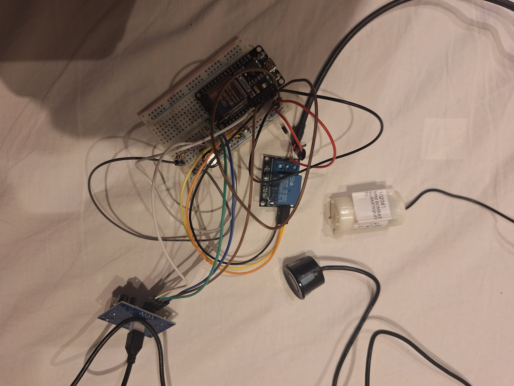

# DrainWatch

Monitoramento do nível de água com ESP32 e dreno automático por bomba.

Disciplina: Conectividade em Sistemas Ciberfísicos · Engenharia de Software · PUCPR

## Problema resolvido

Bueiros e reservatórios enchem sem aviso e só se descobre quando transborda. O DrainWatch mede o nível de água com um sensor ultrassônico, mostra a leitura em uma página web e liga uma bomba de dreno quando o nível passa de 70%. O ESP32 roda um **servidor HTTP ativo** na porta 80: o cliente consulta os dados e envia comandos pela rede.

## Equipe

- Guilherme Franco Trevisan Guimarães
- Matheus Schmidt Neitzke

## Arquitetura

```
[Sensor JSN-SR04T] --> [ESP32: servidor HTTP :80] --> [Módulo relé] --> [Bomba de dreno]
                              ^   |
                    comandos  |   | leituras (JSON)
                              |   v
                  [Cliente web: index.html + app.js]
```

- O **ESP32 é o servidor** (modo passivo): escuta na porta 80 e responde às requisições.
- O **cliente web** consulta `/api/status` a cada 2 segundos e envia comandos para `/api/bomba`.
- O diagrama de arquitetura fica em `docs/arquitetura.png`.

## Hardware

| Componente | Função |
|---|---|
| ESP32 DevKit (30 pinos) | Microcontrolador com Wi-Fi e servidor HTTP |
| Sensor ultrassônico JSN-SR04T | Mede a distância da sonda até a água |
| Módulo relé de 1 canal, 5 V | Liga e desliga a bomba |
| Mini bomba submersível 3 a 6 V | **Atuador**: leva a água para outro recipiente |
| Resistores de 1 kΩ (3) | Divisor de tensão do pino ECHO (5 V para cerca de 3,3 V) |
| Diodo 1N4007 e capacitor | Proteção contra picos da bomba |
| Power bank 5 V, caixa IP67, protoboard | Energia e montagem |

### Pinagem

| Origem | Pino do ESP32 | Observação |
|---|---|---|
| Sensor TRIG | D27 (GPIO 27) | Saída |
| Sensor ECHO | D26 (GPIO 26) | Entrada, **através do divisor de tensão** |
| Relé IN (S) | D13 (GPIO 13) | O relé liga com nível alto |
| Alimentação | VIN (5 V) e GND | Distribuídos pelos trilhos da protoboard |

Bomba: o borne COM do relé vai a 5 V, o NO vai ao fio positivo da bomba e o fio negativo da bomba vai ao GND. Esquemas em `docs/esquematico_sensor.png` e `docs/esquematico_potencia.png`.

## Parâmetros do projeto (em `src/esp32/esp32.ino`)

| Constante | Valor | Significado |
|---|---|---|
| `ALTURA_BALDE` | 45 cm | Altura do recipiente |
| `ELEVACAO` | 20 cm | Altura da sonda acima da borda |
| `NIVEL_MAX` | 40 cm | Nível de água que vale 100% |
| Atenção / Crítico | 50% / 70% | Limites de status |
| Bomba desliga | abaixo de 30% | Evita ligar e desligar sem parar |

Proteções da bomba: não liga com o sensor sem leitura, nem com pouca água (evita rodar a seco), e para sozinha após 2 minutos contínuos.

## API (HTTP, porta 80)

| Rota | Método | Função |
|---|---|---|
| `/api/status` | GET | Leituras, estado da bomba, IP, MAC, rede e hora |
| `/api/bomba?estado=on\|off\|auto` | GET | Liga, desliga ou volta ao modo automático |
| `/api/hora?t=EPOCH` | GET | Ajusta o relógio do ESP32 |
| `/api/log` | GET | Log persistente em memória flash (INFO, AVISO e ERRO) |
| `/api/log/limpar` | GET | Apaga o log |
| `/api/simular?d=45` | GET | **Só em desenvolvimento** (`SIMULAR 1`): define a distância lida |

Exemplo de resposta de `/api/status`:

```json
{"distancia_cm":45.0,"nivel_cm":20.0,"percentual":50.0,"status":"atencao",
 "bomba":{"modo":"auto","estado":"desligada","bloqueio":"","tempo_ligada_s":0},
 "ip":"192.168.0.50","mac":"AA:BB:CC:DD:EE:FF","ssid":"MinhaRede","rede":"estacao",
 "porta":80,"wifi_rssi":-58,"hora_sincronizada":true,"hora":"2026-11-12 10:30:00","uptime_s":312}
```

## Instalação e execução

1. Instale a **Arduino IDE 2.x** e o pacote de placas **esp32 by Espressif Systems** (URL de gerenciador de placas: `https://espressif.github.io/arduino-esp32/package_esp32_index.json`).
2. Abra `src/esp32/esp32.ino`. O arquivo precisa ficar numa pasta de mesmo nome (`esp32`).
3. Preencha `REDE1` e `SENHA1` (Wi-Fi de 2,4 GHz). **Não envie senhas reais ao GitHub.**
4. Escolha a placa **ESP32 Dev Module**, a porta COM e clique em Upload. Se travar em "Connecting...", segure o botão BOOT.
5. Abra o Monitor Serial (115200) e anote o IP.
6. Abra `src/client/index.html` no navegador, digite o IP e clique em **Conectar**.

Se nenhuma rede conhecida estiver disponível, o ESP32 cria a rede `DrainWatch` (IP `192.168.4.1`).

## Testes e evidências

Ambiente: ESP32 e computador (Windows 11) na mesma rede Wi-Fi de 2,4 GHz; IP do ESP32: 192.168.18.167.

| Teste | O que verifica | Evidência |
|---|---|---|
| T1 | Conectividade IP (`ping`): 4 enviados, 4 recebidos, 0% de perda, média de 82 ms | `docs/testes/T1_ping.png` |
| T2 | Porta 80 aberta (`Test-NetConnection`): `TcpTestSucceeded: True` | `docs/testes/T2_porta80.png` |
| T3 | Comunicação cliente-servidor (`curl -i /api/status`): `200 OK` e JSON com IP e MAC | `docs/testes/T3_curl.png` |
| T4 | Sensor lido pela rede e comparado com a trena (tabela abaixo) | `docs/testes/T4_pagina_38cm.jpg`, `docs/testes/T4_trena_38cm.jpg` |
| T5 | Comando da bomba pela rede, pelo cliente, com registro no log | `docs/testes/T5_*.jpg` |

Medidas do T4, com a sonda apontada para a parede:

| Trena (cm) | Sensor (cm) | Diferença (cm) |
|---|---|---|
| 25 | 25,3 | +0,3 |
| 38 | 38,0 | 0,0 |
| 55 | 55,7 | +0,7 |

No T5 a distância foi simulada pela rota `/api/simular`, apenas para liberar a proteção contra funcionamento a seco. O comando pela rede, o relé e a bomba são reais.

Para repetir os testes:

```bash
ping 192.168.18.167
curl -i http://192.168.18.167/api/status
curl "http://192.168.18.167/api/bomba?estado=on"
curl "http://192.168.18.167/api/bomba?estado=off"
curl http://192.168.18.167/api/log
```

## Demonstração



Os diagramas estão em `docs/arquitetura.png`, `docs/esquematico_sensor.png` e `docs/esquematico_potencia.png`.

## Limitações e trabalhos futuros

- Protótipo com recipiente e protoboard; um bueiro real pediria energia solar, comunicação de longo alcance (LoRa ou celular), caixa IP68 e conector estanque.
- A emenda dos fios da bomba é vedada com fita; um produto final usaria conector estanque.
- O histórico de leituras não é guardado no cliente.

## Uso de ferramentas de IA

(Ajuste este texto ao que a equipe realmente fez.) Usamos o Claude para tirar dúvidas, revisar o código e preparar a documentação. A equipe testou o sistema e é responsável por todo o código e por todo o conteúdo entregue.
